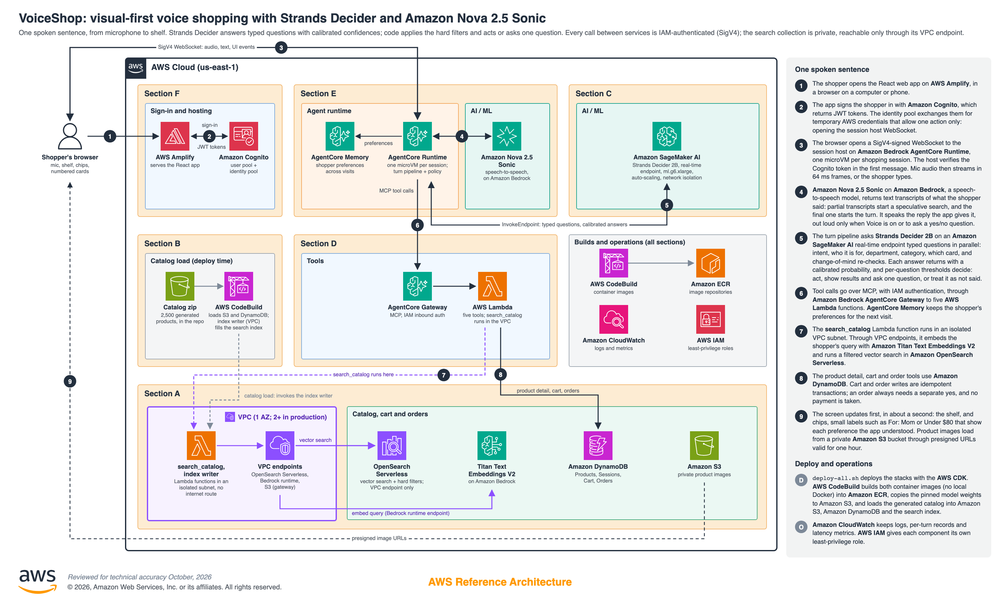

# Build a Decision-Model-First Retail Experience on AWS

## Table of Contents

1. [Overview](#overview)
    - [User request flow](#user-request-flow)
    - [Cost](#cost)
    - [Sample Cost Table](#sample-cost-table)
2. [Prerequisites](#prerequisites)
    - [Operating System](#operating-system)
    - [Third-party tools](#third-party-tools)
    - [AWS account requirements](#aws-account-requirements)
    - [AWS CDK bootstrap](#aws-cdk-bootstrap)
    - [Supported Regions](#supported-regions)
3. [Automated Deployment](#automated-deployment)
4. [Manual Deployment](#manual-deployment)
5. [Deployment Validation](#deployment-validation)
6. [Running the Sample](#running-the-sample)
7. [Next Steps](#next-steps)
8. [Cleanup](#cleanup)
9. [Notices](#notices)
10. [FAQ, Known Issues, Additional Considerations, and Limitations](#faq-known-issues-additional-considerations-and-limitations)
11. [Revisions](#revisions)
12. [Authors](#authors)

## Overview

This sample demonstrates how to build a visual-first voice shopping assistant that is driven by a decision model. The shopper sees a shelf of numbered products and talks or types: "a gift for my mom under eighty dollars", "show me watches", "number 3", "add it to my cart". Each sentence becomes a few typed questions (what the shopper wants to do, who the item is for, which department and category, what budget, which card). **Strands Decider 2B** answers each question with calibrated per-option probabilities. Code then applies the hard rules (budget, department, category, gender, availability). The assistant acts when the decider is sure, asks one short question when it is not, and always confirms before it places an order. The sample addresses a common problem with voice commerce: a general-purpose model that guesses quietly when it is unsure, which leads to wrong filters, wrong items in the cart, and lost trust.

The sample uses **Strands Decider 2B** on an **Amazon SageMaker AI** real-time endpoint for decisions, and **Amazon Bedrock AgentCore Runtime** to host one isolated session per shopper. **Amazon Nova 2.5 Sonic** handles speech in and, optionally, speech out, and the **Strands Agents** framework (`BidiAgent`) connects it to the session. **Amazon Bedrock AgentCore Gateway** exposes the tools over the **Model Context Protocol (MCP)**. **Amazon OpenSearch Serverless** with **Amazon Titan Text Embeddings V2** runs private vector search. **Amazon DynamoDB** stores products, sessions, carts and orders. All infrastructure is deployed with the **AWS Cloud Development Kit (AWS CDK)**. The product catalog (about 2,500 products with photos) was generated for this sample with models on Amazon Bedrock, so it contains no third-party product data. This is a reference sample, not a production retail system: no payment is ever taken.

The architecture is split into six sections:



**Section A: Backend infrastructure.** Six CDK stacks deploy the store:
- a **VPC** with one isolated subnet and no internet route, with VPC endpoints for Amazon OpenSearch Serverless, Amazon Bedrock runtime and Amazon S3;
- **Amazon DynamoDB** tables for products, sessions, carts and orders;
- a private **Amazon S3** bucket for product images;
- an **Amazon OpenSearch Serverless** vector collection that accepts requests only through its VPC endpoint;
- six **AWS Lambda** functions;
- **Amazon Cognito** with a user pool, an identity pool and a demo user.

**Section B: Catalog.** An **AWS CodeBuild** job loads the catalog zip from this repository into Amazon S3 and Amazon DynamoDB. A small Lambda function inside the VPC writes the search index.

**Section C: Decision model.** Four CDK stacks set up the decision model:
- the **Amazon ECR** repository;
- a CodeBuild job that copies the Strands Decider 2B weights from Hugging Face to Amazon S3 once;
- a CodeBuild job that builds the inference container on an AWS Deep Learning Containers base image;
- the **Amazon SageMaker AI** real-time endpoint `voiceshop-decider`: ml.g6.xlarge (NVIDIA L4) by default, auto-scaling, with network isolation.

**Section D: AgentCore Gateway.** A CDK stack creates the **Amazon Bedrock AgentCore Gateway** with MCP and IAM authentication. It exposes five Lambda functions as tools: `search_catalog`, `get_product_detail`, `add_to_cart`, `remove_from_cart` and `place_order`.

**Section E: Session host.** Two CDK stacks deploy the session host:
- Amazon ECR, an ARM64 CodeBuild job and **Amazon Bedrock AgentCore Memory** (for shopper preferences across visits);
- the **Amazon Bedrock AgentCore Runtime** with a WebSocket endpoint.

The session host (Python, FastAPI) runs the turn pipeline and the decision policy.

**Section F: Frontend.** A CDK stack creates an **AWS Amplify Hosting** app, and the React frontend is built and pushed to it.

### User request flow

1. The shopper opens the web app on **AWS Amplify Hosting** and signs in. **Amazon Cognito** authenticates the shopper, and the identity pool returns temporary AWS credentials that can only open the session host WebSocket.
2. The browser opens a SigV4-signed WebSocket to **Amazon Bedrock AgentCore Runtime**. It streams microphone audio, or sends typed text. AgentCore Runtime starts one microVM for the session.
3. **Amazon Nova 2.5 Sonic** transcribes the speech. It speaks only when the shopper has turned spoken replies on, or to ask a yes/no question. A partial transcript starts a speculative catalog search, and the final transcript starts the turn.
4. The session host sends typed questions to **Strands Decider 2B** on the **Amazon SageMaker AI** endpoint: the intent, who the item is for, the department, then the category within it, the budget, and which card the shopper means. Each answer comes with a calibrated confidence. Depending on that confidence, the code acts, shows results while asking one short question, or offers a yes/no choice.
5. The session host calls tools through **Amazon Bedrock AgentCore Gateway** (MCP, IAM), which invokes **AWS Lambda** functions. Code enforces every committed filter. **Amazon Bedrock AgentCore Memory** keeps preferences for the next visit.
6. `search_catalog` runs in the VPC. It embeds the query with **Amazon Titan Text Embeddings V2** and runs a filtered vector search in **Amazon OpenSearch Serverless** through the collection's VPC endpoint. Carts and orders are **Amazon DynamoDB** transactions.
7. The chips and the shelf update first, in about one second. Product images arrive as presigned **Amazon S3** URLs.
8. At deploy time, `deploy-all.sh` builds both container images in **AWS CodeBuild** (no local Docker), stores them in **Amazon ECR**, creates the endpoint, and loads the catalog. **Amazon CloudWatch** collects logs, per-turn records and latency metrics. Every role is least-privilege, scoped by **AWS IAM**.

### Cost

You are responsible for the cost of the AWS services used while running this sample. As of October 2026, running it with the default settings in the US East (N. Virginia) Region costs approximately $1,092 per month for 3,000 shopping sessions. About 93% of that is fixed: the GPU instance behind the decider endpoint and the OpenSearch Serverless minimum both bill for every hour the sample is deployed, whether or not anyone is shopping. **Run `./cleanup-all.sh` when you finish testing or recording.**

We recommend creating a [Budget](https://docs.aws.amazon.com/cost-management/latest/userguide/budgets-managing-costs.html) through [AWS Cost Explorer](https://aws.amazon.com/aws-cost-management/aws-cost-explorer/) to help manage costs. Prices are subject to change. For full details, refer to the pricing webpage for each AWS service used in this sample.

### Sample Cost Table

The following table shows a sample monthly cost breakdown for the default parameters in the US East (N. Virginia) Region. It assumes 3,000 shopping sessions per month, with spoken replies off (the default). The per-session usage of Nova 2.5 Sonic and AgentCore Runtime was measured in Amazon CloudWatch over 71 test sessions (October 2026, about 6 minutes of connection time each). The table does not account for AWS Free Tier benefits.

| AWS service | Dimensions | Cost [USD] |
| ----------- | ---------- | ---------- |
| [Amazon SageMaker AI](https://aws.amazon.com/sagemaker/ai/pricing/) | Real-time endpoint, 1 × ml.g6.xlarge ($1.1267/hour), 730 hours | $822.49 |
| [Amazon OpenSearch Serverless](https://aws.amazon.com/opensearch-service/pricing/) | Vector collection, standby replicas disabled: minimum 1 OCU (0.5 indexing + 0.5 search) at $0.24/OCU-hour, under 1 GB storage | $175.20 |
| [AWS PrivateLink](https://aws.amazon.com/privatelink/pricing/) | 2 interface endpoints (OpenSearch Serverless, Bedrock runtime) in one Availability Zone, $0.01/hour each | $14.60 |
| [Amazon Bedrock (Nova 2.5 Sonic)](https://aws.amazon.com/nova/pricing/) | Measured per session: about 1,230 speech input, 400 speech output, 2,000 text input and 300 text output tokens | $30.00 |
| [Amazon Bedrock AgentCore Runtime](https://aws.amazon.com/bedrock/agentcore/pricing/) | Measured per session: about 0.015 vCPU-hours ($0.0895/vCPU-hour) and 1.05 GB-hours of memory ($0.00945/GB-hour), including idle time until the session ends | $33.88 |
| [Amazon Bedrock AgentCore Memory](https://aws.amazon.com/bedrock/agentcore/pricing/) | Short-term events and long-term preference records | $2.00 |
| [Amazon Bedrock AgentCore Gateway](https://aws.amazon.com/bedrock/agentcore/pricing/) | About 60,000 tool invocations, 5 tools | $0.30 |
| [Amazon Bedrock (Titan Text Embeddings V2)](https://aws.amazon.com/bedrock/pricing/) | About 60,000 query embeddings, about 20 tokens each | $0.02 |
| [Amazon Cognito](https://aws.amazon.com/cognito/pricing/) | 1,000 monthly active users | $5.50 |
| [AWS Lambda](https://aws.amazon.com/lambda/pricing/) | About 60,000 invocations, 512 MB, about 400 ms average duration | $0.21 |
| [Amazon DynamoDB](https://aws.amazon.com/dynamodb/pricing/) | 4 tables, on-demand, about 200,000 reads and 30,000 writes | $0.50 |
| [Amazon S3](https://aws.amazon.com/s3/pricing/) | About 2,500 product images, about 150,000 presigned GETs, about 3 GB transfer | $0.35 |
| [Amazon ECR](https://aws.amazon.com/ecr/pricing/) | Decider image (13.5 GB) and session host image | $1.40 |
| [AWS Amplify](https://aws.amazon.com/amplify/pricing/) | Hosting: 5 GB storage, 15 GB bandwidth | $0.50 |
| [Amazon CloudWatch](https://aws.amazon.com/cloudwatch/pricing/) | Logs and metrics for all services | $5.00 |
| | **Estimated Total** | **~$1,091.95** |

**Notes:**
- The decider endpoint is about 75% of the total. ml.g6.xlarge is the smallest full-GPU G6 instance SageMaker AI offers for a real-time endpoint. The fallback ml.g5.xlarge (`--decider-instance-type g5.xlarge`, $1.408/hour) costs about $1,028 per month instead of $822, with the same answers and latency in our tests.
- Usage-based costs are small: about $78 of the total for 3,000 sessions, mostly Nova 2.5 Sonic and AgentCore Runtime memory time. Turning spoken replies on raises the Nova 2.5 Sonic output-token cost.
- The measured sessions were test sessions with spoken replies off, so speech output covers only yes/no confirmations. Longer sessions, or spoken replies on, raise the Nova 2.5 Sonic and AgentCore Runtime costs.
- Each deploy also runs AWS CodeBuild jobs for the image builds and the catalog load (a few dollars per fresh deploy).
- If you keep the decider image between deployments (`./cleanup-all.sh --keep-decider-image`), Amazon ECR storage costs about $1.35 per month. Nothing else runs or bills.

## Prerequisites

### Operating System

These deployment instructions work on **macOS** and **Amazon Linux 2023**, and on other Linux distributions with the tools below. Docker is not required: AWS CodeBuild builds the container images.

- [AWS account](https://signin.aws.amazon.com/signin) with administrator access or sufficient permissions to create the resources listed in this sample

### Third-party tools

Install the following tools before deployment:

- [Node.js](https://nodejs.org/) 22.x (AWS CDK apps and Lambda functions)
- [Python](https://www.python.org/downloads/) 3.12+ (the decider pre-warm step and the test clients)
- [AWS Command Line Interface (AWS CLI)](https://docs.aws.amazon.com/cli/latest/userguide/getting-started-install.html) 2.x configured with credentials
- The AWS CDK CLI is installed by `npm ci` in each CDK app and run with `npx cdk`, so no global install is needed.

### AWS account requirements

- IAM permissions to:
  - deploy CDK stacks and CloudFormation templates;
  - create Amazon VPC resources and VPC endpoints;
  - create Amazon SageMaker AI models, endpoint configurations and endpoints;
  - create Amazon Bedrock AgentCore Runtimes, Gateways and Memory;
  - create Amazon OpenSearch Serverless collections and policies;
  - create AWS Lambda functions, Amazon DynamoDB tables, Amazon S3 buckets and Amazon ECR repositories;
  - create AWS CodeBuild projects, Amazon Cognito user pools and identity pools, and AWS Amplify apps.
- Amazon Bedrock model access for **Amazon Nova 2.5 Sonic** and **Amazon Titan Text Embeddings V2**. Request access in the [Amazon Bedrock console](https://console.aws.amazon.com/bedrock/) if it is not already enabled. Anthropic Claude and Stability AI models are needed only to regenerate the catalog ([generator](backend/catalog-data/README.md#generator)).
- Room for **one more VPC** in the Region: VoiceShop creates its own VPC, and the default quota "VPCs per Region" is 5. Check it in Service Quotas (Amazon VPC) and request an increase if the account already has 5.
- Amazon SageMaker AI quota **"ml.g6.xlarge for endpoint usage"** of at least `--decider-max-instances` (default 1). Find it in [Service Quotas](https://console.aws.amazon.com/servicequotas/). For another `--decider-instance-type`, you need that type's quota instead. New accounts often start at 0. `deploy-all.sh` checks the quota before it deploys anything.

### AWS CDK bootstrap

`deploy-all.sh` bootstraps the AWS CDK for this sample only: it creates the stack `VoiceShop-CDKToolkit` with qualifier `voiceshop`. That way `cleanup-all.sh` can remove every uploaded asset without touching the account's shared `CDKToolkit` stack. For a manual deployment, run the bootstrap yourself (step 2 of [Manual Deployment](#manual-deployment)).

### Supported Regions

The sample deploys to **us-east-1** by default. To use another Region, set `VOICESHOP_REGION`. The Region must offer:
- Amazon Nova 2.5 Sonic;
- Amazon Bedrock AgentCore (Runtime, Gateway and Memory);
- Amazon OpenSearch Serverless;
- the SageMaker AI GPU instance type you choose.

Check the [Amazon Bedrock pricing page](https://aws.amazon.com/bedrock/pricing/) and the [AWS Regional Services list](https://aws.amazon.com/about-aws/global-infrastructure/regional-product-services/) for current availability.

## Automated Deployment

For automated deployment, use the deploy script `deploy-all.sh`. It runs every deployment step, including dependency installation, the CDK bootstrap, image builds, the catalog load and a pre-warm of the decider endpoint.

**Usage:**

```bash
# Clone the repository
git clone https://github.com/aws-samples/sample-voice-ai-shopping-with-strands-decider-and-amazon-nova-sonic
cd sample-voice-ai-shopping-with-strands-decider-and-amazon-nova-sonic

# Make the script executable and run it
chmod +x deploy-all.sh cleanup-all.sh codebuild-scripts/build-image.sh
./deploy-all.sh --user-email your-email@example.com
```

**Required parameters:**
- `--user-email`: a valid, accessible email address. Amazon Cognito sends the temporary password for the demo user `AppUser` to it. This parameter is required on the first deploy only.

**Optional parameters:**
- `--user-name`: display name of the demo user (default `AppUser`). The sign-in username is always `AppUser`.
- `--decider-instance-type`: the decider GPU instance, without `ml.` (default `g6.xlarge`; `g5.xlarge` and `g6e.xlarge` also work). To change the type of a deployed endpoint, see [Known issues](#known-issues).
- `--decider-max-instances`: the upper bound for decider auto-scaling (default 1). It must not exceed your quota.
- `--skip-catalog`: skip loading the catalog.

**What the script does:**
- Checks the SageMaker AI GPU quota, then bootstraps the CDK (`VoiceShop-CDKToolkit`).
- Runs two chains side by side:
  - **Decider chain**, in the background, logging to `deploy-decider.log`: the ECR repository and decider infrastructure, the one-time model upload (in CodeBuild), the image build (about 16 minutes), and the SageMaker AI endpoint (about 9 minutes).
  - **Main chain**: the backend infrastructure, the catalog, the AgentCore Gateway, the session host (infrastructure, ARM64 image build, runtime) and the frontend on AWS Amplify.
- Waits for both chains, then pre-warms the decider endpoint and prints its latency.
- Prints the Amplify URL.

A fresh deploy took about 31 minutes (measured October 2026). Creating the SageMaker AI endpoint can take 30 minutes or more when GPU capacity is tight; in one test account it waited 23 minutes for an instance, and the whole deploy took 53 minutes. Re-running the script is safe: stacks update in place, and images that are already built are skipped.

**Environment:**
- Designed for macOS and Linux, including Amazon Linux 2023 on Amazon EC2.
- On a Mac, the script keeps the computer awake with `caffeinate` while it runs.
- Use a credentials profile that refreshes itself, for example AWS IAM Identity Center or `credential_process`: `AWS_PROFILE=<profile> ./deploy-all.sh ...`. Some steps wait 15 minutes or more, so short-lived credentials can expire mid-run.

**Note:** For a detailed understanding of each deployment step, see the [Manual Deployment](#manual-deployment) section below.

## Manual Deployment

Follow these steps to deploy each component individually. Deploy in the order listed, because later components depend on outputs from earlier ones. Each CDK app reads its bootstrap qualifier from its own `cdk.json`, and stacks find each other's resources through CloudFormation exports, so no values need to be copied between steps.

1. Clone the repository, and set the Region:
   ```bash
   git clone https://github.com/aws-samples/sample-voice-ai-shopping-with-strands-decider-and-amazon-nova-sonic
   cd sample-voice-ai-shopping-with-strands-decider-and-amazon-nova-sonic
   export AWS_REGION=us-east-1 AWS_DEFAULT_REGION=us-east-1 CDK_DEFAULT_REGION=us-east-1
   ```

2. Bootstrap the CDK for this sample:
   ```bash
   cd backend/backend-infrastructure
   npm ci
   npx cdk bootstrap aws://<ACCOUNT_ID>/us-east-1 \
     --qualifier voiceshop --toolkit-stack-name VoiceShop-CDKToolkit --tags Project=VoiceShop
   cd ../..
   ```
   Replace `<ACCOUNT_ID>` with your AWS account ID.

3. Deploy the backend infrastructure. This creates the VPC, the DynamoDB tables, the images bucket, the search collection, the Lambda functions and Cognito:
   ```bash
   cd backend/backend-infrastructure
   npx cdk deploy VoiceShop-NetworkStack VoiceShop-DynamoDBStack VoiceShop-StorageStack VoiceShop-SearchStack \
     VoiceShop-LambdaStack VoiceShop-CognitoStack \
     --require-approval never \
     --parameters VoiceShop-CognitoStack:UserEmail="your-email@example.com" \
     --outputs-file cdk-outputs/backend-infrastructure.json
   cd ../..
   ```

4. Load the catalog. This deploys the curation CodeBuild project and runs it. The job loads images to Amazon S3 and products to DynamoDB, then calls the index writer inside the VPC to fill the search index:
   ```bash
   cd backend/catalog-data/cdk
   npm ci
   npx cdk deploy VoiceShop-CatalogDataStack --require-approval never --outputs-file cdk-outputs/catalog-data.json
   cd ../../..
   ./codebuild-scripts/build-image.sh VoiceShop-CatalogCuration 20
   ```

5. Deploy the decision model. You can run this step in a second terminal while you continue with steps 6–9. It uploads the model weights to S3 once, builds the inference image (about 16 minutes), and creates the SageMaker AI endpoint (about 9 minutes):
   ```bash
   cd backend/decider-runtime/cdk
   npm ci
   npx cdk deploy VoiceShop-DeciderImageStack VoiceShop-DeciderInfraStack --require-approval never
   cd ../../..
   ./codebuild-scripts/build-image.sh VoiceShop-DeciderModelUpload 20
   ./codebuild-scripts/build-image.sh VoiceShop-DeciderBuild 30
   cd backend/decider-runtime/cdk
   npx cdk deploy VoiceShop-DeciderEndpointStack --require-approval never --outputs-file cdk-outputs/decider.json
   cd ../../..
   ```
   To use another instance type or allow scaling, add `--context deciderInstanceType=g6.xlarge --context deciderMaxInstances=2` to both `cdk deploy` commands.

6. Deploy the AgentCore Gateway. This creates the MCP gateway with the five Lambda tools:
   ```bash
   cd backend/agentcore-gateway/cdk
   npm ci
   npx cdk deploy VoiceShop-AgentCoreGatewayStack --require-approval never --outputs-file cdk-outputs/agentcore-gateway.json
   cd ../../..
   ```

7. Deploy the session host infrastructure, and build its image. This creates the ECR repository, the ARM64 CodeBuild project, AgentCore Memory and the runtime role, then builds and pushes the image:
   ```bash
   cd backend/agentcore-runtime/cdk
   npm ci
   npx cdk deploy VoiceShop-AgentCoreInfraStack --require-approval never --outputs-file cdk-outputs/agentcore-infra.json
   cd ../../..
   ./codebuild-scripts/build-image.sh VoiceShop-SessionHostBuild 30
   ```

8. Deploy the AgentCore Runtime with the session host:
   ```bash
   cd backend/agentcore-runtime/cdk
   npx cdk deploy VoiceShop-AgentCoreRuntimeStack --require-approval never --outputs-file cdk-outputs/agentcore-runtime.json
   cd ../../..
   ```

9. Deploy the frontend. This creates the Amplify app, then builds the React app and pushes it:
   ```bash
   cd frontend
   npm ci
   (cd cdk && npm ci && npx cdk deploy VoiceShop-FrontendStack --require-approval never --outputs-file cdk-outputs/frontend.json)
   npm run deploy:amplify
   cd ..
   ```
   Find the `AmplifyAppUrl` in `frontend/cdk/cdk-outputs/frontend.json` under the `VoiceShop-FrontendStack` key.

10. When the endpoint from step 5 is `InService`, pre-warm it. The first requests after creation are slow while the GPU kernels compile:
    ```bash
    pip3 install boto3
    python3 backend/decider-runtime/scripts/prewarm.py --region us-east-1
    ```

11. Sign in to the frontend as `AppUser` with the temporary password from the Cognito invitation email. Then set a permanent password when you're prompted.

## Deployment Validation

Verify that all components deployed successfully by running the following checks.

1. **Verify CloudFormation stacks.** Open the [AWS CloudFormation console](https://console.aws.amazon.com/cloudformation/) and confirm that the following stacks show `CREATE_COMPLETE` or `UPDATE_COMPLETE`:
   - `VoiceShop-CDKToolkit`
   - `VoiceShop-NetworkStack`
   - `VoiceShop-DynamoDBStack`
   - `VoiceShop-StorageStack`
   - `VoiceShop-SearchStack`
   - `VoiceShop-LambdaStack`
   - `VoiceShop-CognitoStack`
   - `VoiceShop-CatalogDataStack`
   - `VoiceShop-DeciderImageStack`
   - `VoiceShop-DeciderInfraStack`
   - `VoiceShop-DeciderEndpointStack`
   - `VoiceShop-AgentCoreGatewayStack`
   - `VoiceShop-AgentCoreInfraStack`
   - `VoiceShop-AgentCoreRuntimeStack`
   - `VoiceShop-FrontendStack`

   Alternatively, list them from the CLI:
   ```bash
   aws cloudformation list-stacks --region us-east-1 \
     --query "StackSummaries[?starts_with(StackName,'VoiceShop-') && StackStatus!='DELETE_COMPLETE'].[StackName,StackStatus]" --output table
   ```

2. **Verify the decider endpoint.** Confirm that it is `InService`, and send a test request:
   ```bash
   aws sagemaker describe-endpoint --endpoint-name voiceshop-decider --region us-east-1 --query EndpointStatus
   python3 backend/decider-runtime/scripts/prewarm.py --region us-east-1
   ```
   Expected output: `"InService"`, then a confirmation that a GPU answered the questions, and client p50/p95 latencies for 20 warm requests.

3. **Verify the AgentCore Gateway tools.** List the MCP tools, and call each one:
   ```bash
   pip3 install mcp mcp-proxy-for-aws boto3
   python3 backend/agentcore-gateway/test-client/gateway-check.py --region us-east-1
   ```
   Expected output: five tools (`search_catalog`, `get_product_detail`, `add_to_cart`, `remove_from_cart`, `place_order`) with passing valid and invalid input checks, and the latency the Gateway adds.

4. **Verify the session host.** Run a scripted text conversation against the deployed runtime:
   ```bash
   pip3 install boto3 websockets
   cat > tester.json <<'EOF'
   {"username": "AppUser", "password": "<your-password>", "client": "<USER_POOL_CLIENT_ID>"}
   EOF
   python3 backend/agentcore-runtime/test-client/text_client.py \
     --credentials tester.json --runtime-arn <AGENT_RUNTIME_ARN>
   ```
   Find `<USER_POOL_CLIENT_ID>` (`UserPoolClientId`) in `backend/backend-infrastructure/cdk-outputs/backend-infrastructure.json`. Find `<AGENT_RUNTIME_ARN>` (`AgentRuntimeArn`) in `backend/agentcore-runtime/cdk/cdk-outputs/agentcore-runtime.json`.

   Expected output: the chips, shelf and reply for each sentence of the default script ("a gift for my mom under eighty dollars", "something in purple", "the second one", "yes, add it to my cart", "place my order"). Delete `tester.json` afterwards.

## Running the Sample

After deployment and validation, open the store and shop by voice or text.

### Inputs

- **Cognito credentials:** username `AppUser` and the password you set at first sign-in.
- **Microphone access:** the browser asks for permission the first time you turn the microphone on.

### Using the frontend

1. Open the Amplify URL from the deployment output in your browser.
2. Sign in as `AppUser`.
3. Turn on the microphone and speak, or type in the search bar. Before a demo, say one or two sentences first: the first request after a deploy can take a few seconds.

What you can do:
- **Pointing.** Every card shows its number. Say "number 5", "the second one" or describe the item. When the assistant is unsure, it asks "Do you mean No. 5, ...?". Tapping a card always works.
- **Chips.** Committed choices appear as chips with their confidence. Click a chip to remove it. You can change your mind at any time ("actually it's for my dad"): a new recipient clears the earlier details.
- **More results and moving around.** "Show me more" adds the next 12 results, up to 49. "Scroll down" and "back to the top" move the page. "Close it" closes the open product.
- **No match.** The closest items stay on screen, and the assistant offers to drop one filter. Say "yes" to widen the search.
- **Yes/no questions.** They show Yes and No buttons. If the browser already allows the microphone for the site, it opens by itself so you can answer by voice.
- **Cart.** Say "add it to my cart". If the item is already in the cart, the assistant asks "Should I add another one?" first. Remove an item by voice ("remove the blouse from my cart") or with its ×. When the cart holds more than one of an item, "remove one" takes out one and keeps the rest, and "remove both" takes out the line. "Empty my cart" asks first.
- **Orders.** "Place my order" always asks "Should I place the order?" first. If the cart is empty, the assistant says so. An order is a DynamoDB record, and nothing is charged.
- **Voice on / Voice off.** Spoken replies are off by default, and the chat shows the reply text instead. The header toggle turns spoken replies on. Yes/no confirmations are spoken either way.
- **Behind the scenes.** Press **D**, or use **Debug overlay** in the footer, to see each sentence's decider questions and answers, catalog searches, DynamoDB writes and timings. **Pop out** moves the panel to its own window, for example to keep it beside the store while you record.

### Example conversation

An illustrative session. The bracketed lines show what the debug overlay reports; your products, numbers and confidences will differ.

```
Shopper: A gift for my mom under eighty dollars.

Store:   [Decider: intent = look for products 97%, recipient = parent 91%,
          gender = women 88%, budget = under $80 95%]
         Chips: For mom · Women · Under $80. The shelf shows 12 gift ideas.
         "Which part of the store: jewelry, bags or clothing?"

Shopper: Something in jewelry.

Store:   [Decider: department = jewelry 93%; category unsure]
         Chips: + Jewelry. The shelf shows necklaces, earrings and bracelets.

Shopper: Show me number three.

Store:   [Decider: intent = pick an item 96%, pointed item = No. 3 94%]
         Opens No. 3, a silver pendant necklace, $64.

Shopper: Yes, add it to my cart.

Store:   [Tool: add_to_cart] "Added the silver pendant necklace to your cart."
         The product panel closes.

Shopper: Actually, it's for my wife.

Store:   [Decider: recipient changed to partner 89%]
         The chips reset to For wife; the shelf updates.

Shopper: Place my order.

Store:   "Should I place the order?" [Yes] [No]

Shopper: Yes.

Store:   [Tool: place_order] "Your order is placed."
```

### Debugging and logging

- **Debug overlay:** press **D** in the store for each turn's decider questions, answers, confidences and timings.
- **Frontend logs:** the browser console (F12) shows WebSocket events and errors.
- **Session host logs:** Amazon CloudWatch Logs at `/aws/bedrock-agentcore/runtimes/<runtime-id>-DEFAULT`.
- **Decider endpoint logs:** Amazon CloudWatch Logs at `/aws/sagemaker/Endpoints/voiceshop-decider`.
- **Lambda logs:** Amazon CloudWatch Logs at `/aws/lambda/VoiceShop-<function-name>`.
- **Build logs:** Amazon CloudWatch Logs at `/aws/codebuild/VoiceShop-<project-name>`; the decider chain also logs to `deploy-decider.log` locally.

## Next Steps

Consider the following enhancements after you deploy this sample:

- **Use your own catalog.** Replace the generated catalog zip with your products ([catalog README](backend/catalog-data/README.md)). For incremental updates in production, see [Catalog updates in production](docs/catalog-updates-in-production.md).
- **Tune the decisions without training.** Edit the question wording, options and calibrated thresholds in the session host, and re-run the labeled evaluation in `backend/agentcore-runtime/eval/`. See [How we tuned it](docs/how-we-tuned-it.md).
- **Add new tools.** Add a Lambda function in `backend/backend-infrastructure/lib/lambda-stack.ts` and its schema in `backend/agentcore-gateway/cdk/lib/tool-schemas.ts`, then redeploy both stacks.
- **High availability.** Run the search VPC in two or more Availability Zones, and set `--decider-max-instances` to 2 or more so the endpoint can scale out ([ADR-32](docs/architecture-decisions.md#adr-32-private-search-collection)).
- **Payment integration.** Connect `place_order` to a payment provider. The sample records orders in DynamoDB only.
- **CI/CD pipeline.** Set up AWS CodePipeline for automated testing and deployment of the session host, the decider container and the infrastructure.
- **Monitoring and alerting.** Build Amazon CloudWatch dashboards and alarms for per-turn latency, decider errors and cost.
- **Multi-language support.** Amazon Nova 2.5 Sonic supports more languages. Extend the question wording and the prompts to match.

## Cleanup

Remove all deployed resources to stop incurring charges.

### Automated cleanup

Preview what will be deleted, then run the cleanup:

```bash
# Preview deletions (no resources are removed)
./cleanup-all.sh --dry-run

# Delete all resources (asks to confirm; --force skips the prompt)
./cleanup-all.sh

# Delete everything except the decider image, for a faster redeploy
./cleanup-all.sh --keep-decider-image
```

The script deletes the stacks in the reverse of their deployment order:
1. The frontend (`VoiceShop-FrontendStack`).
2. The session host (`VoiceShop-AgentCoreRuntimeStack`, `VoiceShop-AgentCoreInfraStack`).
3. The AgentCore Gateway (`VoiceShop-AgentCoreGatewayStack`).
4. The decision model (`VoiceShop-DeciderEndpointStack`, `VoiceShop-DeciderInfraStack`, `VoiceShop-DeciderImageStack`). Deleting the endpoint stops the GPU instance and its billing.
5. The catalog (`VoiceShop-CatalogDataStack`).
6. The backend infrastructure (`VoiceShop-CognitoStack`, `VoiceShop-LambdaStack`, `VoiceShop-SearchStack`, `VoiceShop-StorageStack`, `VoiceShop-DynamoDBStack`, `VoiceShop-NetworkStack`).

It then removes the log groups that services create outside the stacks, the local deploy outputs, and `VoiceShop-CDKToolkit` with its asset bucket and repository. Only VoiceShop-named resources are touched. The account's shared `CDKToolkit` stack is left alone.

A full cleanup took about 44 minutes (measured October 2026). About 24 of those minutes were `VoiceShop-LambdaStack`, while AWS released the network interfaces of the two VPC functions.

### Redeploying faster: keep the decider image

Each fresh deploy builds the decider container image from source in AWS CodeBuild, which takes about 16 minutes. The build pulls the AWS Deep Learning Containers base image from Amazon ECR Public, installs Strands Decider, PyTorch and a compiled CUDA extension, then pushes the result to your private Amazon ECR repository. If you plan to deploy again, keep the image:

```bash
./cleanup-all.sh --keep-decider-image   # everything is deleted except VoiceShop-DeciderImageStack
./deploy-all.sh                          # later: the image is found in ECR and the build step is skipped
```

- **What is kept:** only `VoiceShop-DeciderImageStack`, the ECR repository with the built image (13.5 GB compressed). ECR storage for it costs about $1.35 per month, and nothing else runs or bills.
- **What is saved:** the image build. The decider steps run in parallel with the rest of the deploy, so the whole deploy gets only a few minutes shorter: from about 31 to about 28 minutes, because the other steps then take the longest.
- **When it is rebuilt anyway:** the image tag is a hash of `backend/decider-runtime/container/` (the Dockerfile, requirements and `serve.py`). If you change any of them, the next deploy builds and uses a new image.
- **Removing it later:** run `./cleanup-all.sh` without the flag.

### Manual cleanup

To remove components individually, destroy them in reverse order. Run each command from the directory shown:

1. `frontend/cdk`: `npx cdk destroy VoiceShop-FrontendStack --force`
2. `backend/agentcore-runtime/cdk`: `npx cdk destroy VoiceShop-AgentCoreRuntimeStack VoiceShop-AgentCoreInfraStack --force`
3. `backend/agentcore-gateway/cdk`: `npx cdk destroy VoiceShop-AgentCoreGatewayStack --force`
4. `backend/decider-runtime/cdk`: `npx cdk destroy VoiceShop-DeciderEndpointStack VoiceShop-DeciderInfraStack VoiceShop-DeciderImageStack --force`
5. `backend/catalog-data/cdk`: `npx cdk destroy VoiceShop-CatalogDataStack --force`
6. `backend/backend-infrastructure`: `npx cdk destroy --all --force`
7. Delete `VoiceShop-CDKToolkit`: empty its S3 bucket and ECR repository first, then run `aws cloudformation delete-stack --stack-name VoiceShop-CDKToolkit`.

### Verify cleanup

Confirm that no VoiceShop stacks remain:

```bash
aws cloudformation list-stacks --region us-east-1 \
  --query "StackSummaries[?starts_with(StackName,'VoiceShop-') && StackStatus!='DELETE_COMPLETE'].StackName" --output text
```

Expected output: nothing, or only `VoiceShop-DeciderImageStack` if you used `--keep-decider-image`. Also confirm in the [Amazon SageMaker AI console](https://console.aws.amazon.com/sagemaker/home#/endpoints) that the `voiceshop-decider` endpoint is gone.

## Notices

*Customers are responsible for making their own independent assessment of the information in this sample. This sample: (a) is for informational purposes only, (b) represents AWS current product offerings and practices, which are subject to change without notice, and (c) does not create any commitments or assurances from AWS and its affiliates, suppliers or licensors. AWS products or services are provided "as is" without warranties, representations, or conditions of any kind, whether express or implied. AWS responsibilities and liabilities to its customers are controlled by AWS agreements, and this sample is not part of, nor does it modify, any agreement between AWS and its customers.*

Strands Decider weights are licensed under Apache-2.0. Every product, brand, description and image in the catalog was generated for this sample.

## FAQ, Known Issues, Additional Considerations, and Limitations

### Known issues

- **The first request after a deploy is slow.** The first decider request can take several seconds while the GPU kernels compile, even after the pre-warm. Say one or two sentences before a demo.
- **The mic does not open by itself for a yes/no question.** It opens automatically only after the browser has allowed the microphone for this site. Each new Amplify URL is a new site: click the mic once and allow it.
- **No mic audio with a Bluetooth headset on macOS.** The browser may receive silence until the device is selected again. Re-select the headset as the input in the system sound settings or the browser, or use the built-in microphone.
- **"InsufficientInstanceCapacity" when the endpoint is created.** AWS has no free GPUs of that type in the Region at the moment. Re-run with another type, for example `--decider-instance-type g5.xlarge`, or retry later.
- **Changing `--decider-instance-type` on a deployed endpoint fails** with "must be deregistered as scalable targets with Application Auto Scaling before they can ... have their instance type updated". SageMaker does not change the instance type of an endpoint that has auto-scaling. Delete the endpoint stack first, then deploy with the new type: `cd backend/decider-runtime/cdk && npx cdk destroy VoiceShop-DeciderEndpointStack --force`, then `./deploy-all.sh --decider-instance-type <type>`. The decider is down for about 11 minutes.
- **A step seems to hang for many minutes on a Mac.** The computer went to sleep. The scripts keep a Mac awake with `caffeinate`, but closing the lid on battery still sleeps it, so keep it open or on power.
- **Credentials expire during a long run.** Use a profile that refreshes itself (IAM Identity Center or `credential_process`), and re-run the script. It continues where stacks are already deployed.
- **The frontend says config values are missing.** The backend stacks are not deployed yet. Run `deploy-all.sh`.
- **Token expiration.** Amazon Cognito tokens expire after 1 hour. Sign in again if the session stops responding.

### Additional considerations

- **The GPU endpoint runs all the time.** The decider endpoint keeps at least one GPU instance running while it is deployed. Clean up when you are not testing.
- **Private search.** The search collection accepts requests only through its VPC endpoint, and each request must be SigV4-signed by a role named in a data access policy. Only the two functions that call it run in the VPC. The decider container has no network access at all ([ADR-32](docs/architecture-decisions.md#adr-32-private-search-collection)).
- **Availability.** The search VPC uses one Availability Zone, and the decider scales to one instance by default. Use two or more zones and instances in production.
- **Data retention.** The Sessions and Cart tables use DynamoDB TTL (`expiresAt`) to remove old items automatically.
- **Compliance.** Make sure voice data handling complies with local regulations (GDPR, CCPA and others) before you deploy to production.
- **Accessibility.** Test the frontend with screen readers and keyboard navigation for accessibility compliance.
- **IAM.** This sample creates one least-privilege IAM role per component. Review the IAM policies in each CDK stack against your organization's security requirements.

### Limitations

- **No payment.** Orders are DynamoDB records only, and nothing is charged.
- **Generated catalog.** About 2,500 generated products in 10 departments. Results reflect that catalog, not a real store.
- **Language support.** The questions and prompts are in English.
- **Voice quality.** Real-time streaming needs a stable internet connection.
- **One item at a time.** The cart adds one item per request. "Add items 1, 5 and 3" is not supported yet.

### Further reading

- [Architecture decisions](docs/architecture-decisions.md)
- [How we tuned it: adapting Strands Decider without training](docs/how-we-tuned-it.md)
- [Catalog updates in production](docs/catalog-updates-in-production.md) (proposed, not implemented)
- [Catalog generator and loader](backend/catalog-data/README.md)
- [Research record](docs/research.md)

### Repository layout

| Path | What it is |
|---|---|
| `backend/backend-infrastructure/` | CDK: the search VPC, DynamoDB, S3, OpenSearch Serverless, the five tool Lambdas and the index writer, Cognito |
| `backend/catalog-data/` | The catalog zip, its generator and the loader job ([README](backend/catalog-data/README.md)) |
| `backend/decider-runtime/` | The Strands Decider container and the SageMaker AI endpoint ([README](backend/decider-runtime/README.md)) |
| `backend/agentcore-gateway/` | The AgentCore Gateway with the Lambda targets ([README](backend/agentcore-gateway/README.md)) |
| `backend/agentcore-runtime/` | The session host (`agent/`), its CDK app, evaluations (`eval/`) and a text test client |
| `frontend/` | The React app and the Amplify stack ([README](frontend/README.md)) |
| `codebuild-scripts/` | Starts a CodeBuild project and waits for it |
| `docs/` | Decisions, tuning notes and research |
| `deploy-all.sh`, `cleanup-all.sh` | Deploy and tear down everything |

For any feedback, questions, or suggestions, use the [Issues tab](https://github.com/aws-samples/sample-voice-ai-shopping-with-strands-decider-and-amazon-nova-sonic/issues) in the repository. See [CONTRIBUTING](CONTRIBUTING.md#security-issue-notifications) for security issue notifications.

## Revisions

- **v1.0.0**: Initial release with Strands Decider 2B on Amazon SageMaker AI, Amazon Nova 2.5 Sonic, Amazon Bedrock AgentCore (Runtime, Gateway, Memory), private Amazon OpenSearch Serverless vector search, and a generated catalog.

## Authors

- Ravi Kumar, Senior TAM
- Salman Ahmed, Senior TAM
- Sergio Barraza, Senior TAM

## License

This library is licensed under the MIT-0 License. See the [LICENSE](LICENSE) file.
